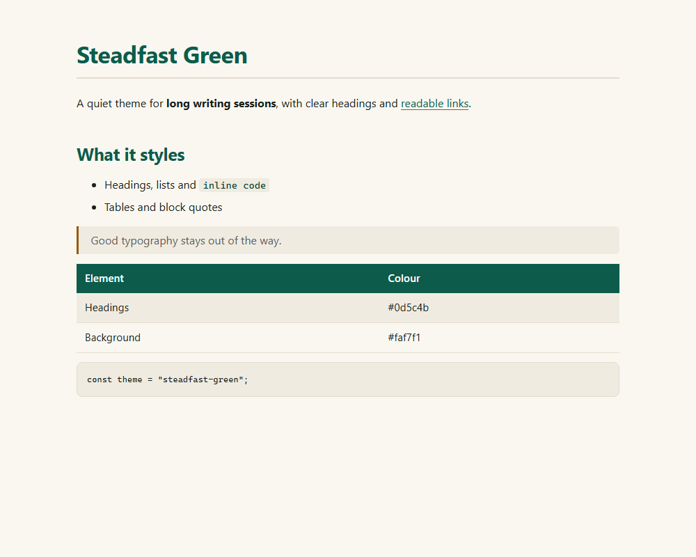
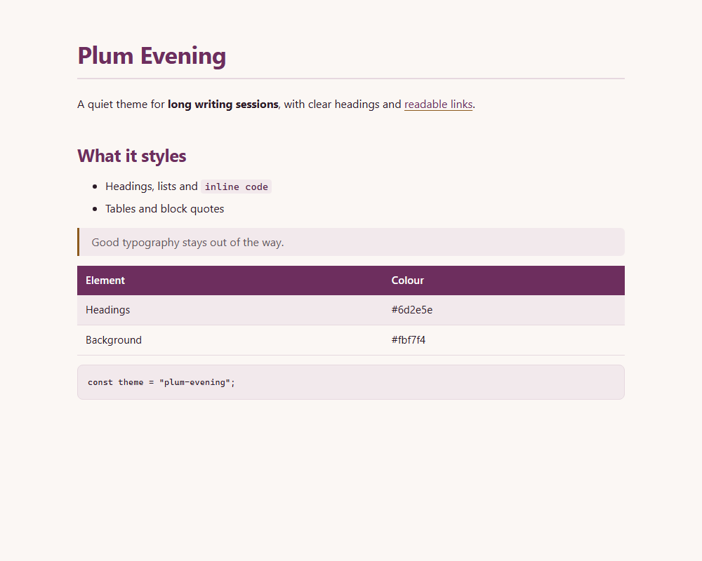
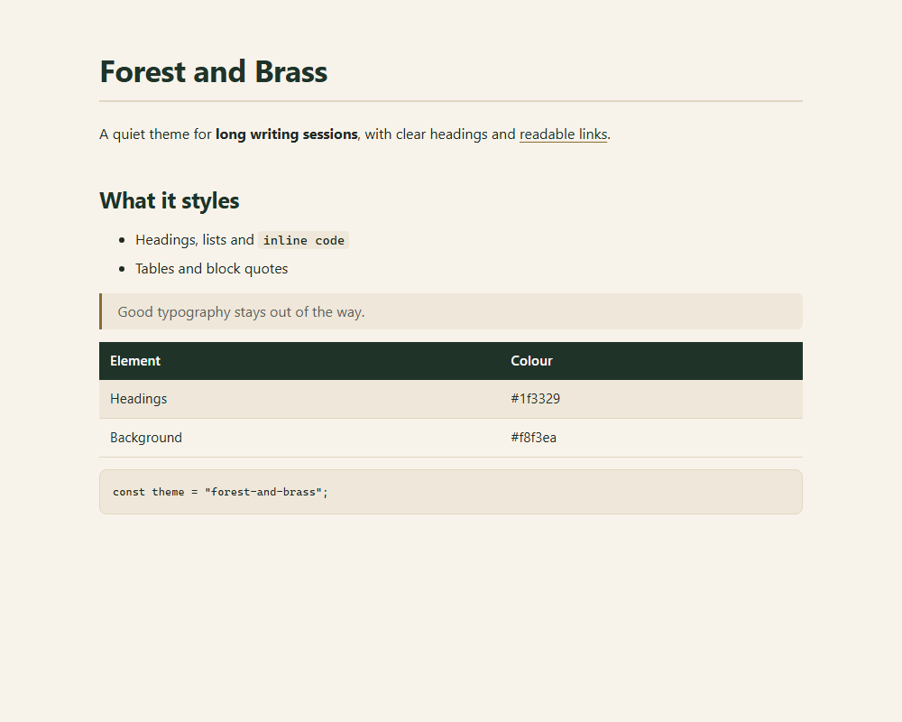
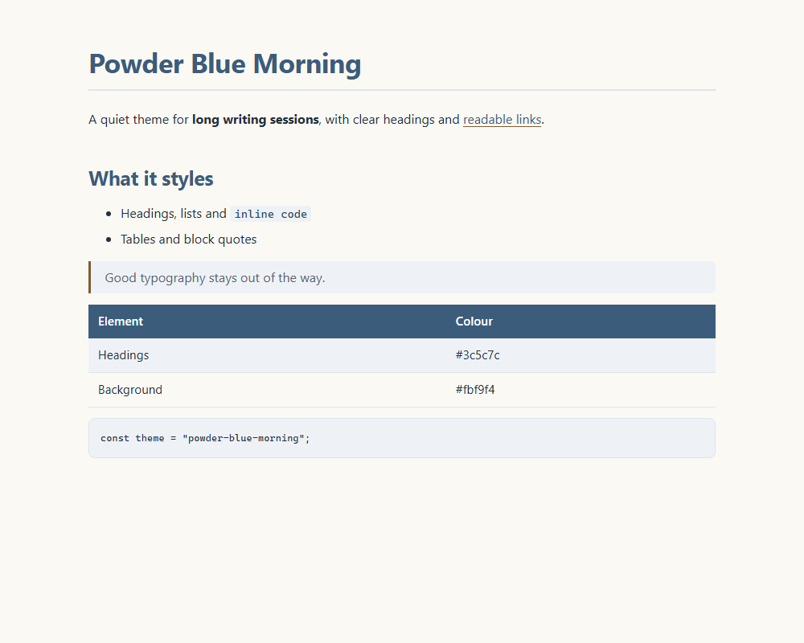

# Steadfast themes for Typora

Four light reading themes for [Typora](https://typora.io/).

| Theme | Preview | Made by |
|---|---|---|
| Steadfast Green |  | [KokybiskaSvetaine.lt](https://kokybiskasvetaine.lt/) |
| Plum Evening |  | [Vestuvių metinės](https://vestuviumetines.lt/) |
| Forest and Brass |  | [Dovanos su vardu](https://dovanasuvardu.lt/) |
| Powder Blue Morning |  | [Krikštynų dovana](https://krikstynudovana.lt/) |

## Install

1. Download this repository.
2. In Typora, open Preferences > Appearance > Open Theme Folder.
3. Copy the `.css` file you want into that folder.
4. Restart Typora and pick the theme in the Themes menu.

## Licence

MIT. See [LICENSE](LICENSE).
